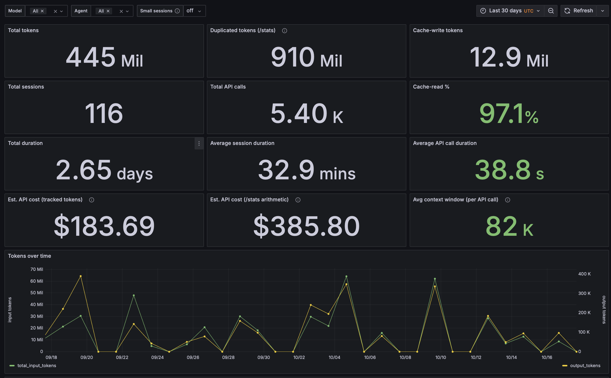

# analyze-claude-sessions

<p align="center">
  
</p>

## Why

Claude Code hides per-call token, cache and cost usage inside local session transcripts.
This tool loads them into PostgreSQL so you can query and chart them.

- One Postgres row per API call, including sub-agent calls.
- Four Grafana dashboards for tokens, cache hit rate, cost and sub-agent lineage.
- An `acp` CLI and Parquet export.
- One command to start: `make dashboard`.

## Resume

This tool analyzes Claude Code session transcripts. It runs in Docker.

The stack has three parts: PostgreSQL 17 with the `pg_parquet` extension, a Python 3.12
ingestion CLI, and a schema built over the per-API-call token and timing reports that
`cache_report_per_call_timing.sh` produces.

- **Stack:** Docker Compose (PostgreSQL 17 + `pg_parquet` 0.5.1, Python 3.12 app, Grafana),
  `uv`, `polars`, `psycopg` 3, `typer`, `ruff`, `mypy`, `pytest`.
- **What it does:** it walks `~/.claude/projects/**/*.jsonl`. It runs the vendored shell
  report on each transcript to produce a CSV. It loads the CSVs and transcript metadata into
  the `claude` schema in PostgreSQL. It shows the data in four Grafana dashboards. It can
  export any table or view to Parquet through `pg_parquet`.
- **Entry point:** `src/analyze_claude_sessions/cli.py` (the `acp` console script).
- **Everything runs in containers.** The host only needs Docker and `make`. `uv` is needed
  only for local dev commands (`make check`) and for the optional `acp ask` tool.

## Agent read
If you are an AI agent, read also [README_AGENT.md](README_AGENT.md).

## Quick start

```bash
make env          # writes .env with your real CLAUDE_PROJECTS_DIR
make build        # builds both images (first run compiles pg_parquet, ~10-20 min)
make up           # starts PostgreSQL, waits for healthy
make init-db      # applies sql/*.sql (also runs automatically on a fresh volume)
make ingest       # loads your transcripts into PostgreSQL
make stats        # prints ingest summary stats
make dashboard    # starts Grafana at http://localhost:3000
```

For every other command — ingest options, backups, pricing, and dev commands — see
**[scripts-guide.md](scripts-guide.md)**.

The cost views support prompt-length pricing tiers (Haiku 5.5 above 100k input tokens is priced
at long-context rates).

## Dashboard

```bash
make dashboard    # or: make up-grafana
```

This starts PostgreSQL plus a provisioned Grafana instance at
`http://localhost:${GRAFANA_PORT:-3000}`. Grafana loads its datasource and four dashboards
automatically from `docker/grafana/`; you do not need to import anything.

Grafana runs with anonymous Editor access and no login, by design for local, single-user
use. Its port is bound to `127.0.0.1` — do not expose it beyond localhost.

| Dashboard | Shows |
| --- | --- |
| **Usage overview** | Token/call/duration totals, two estimated-API-cost panels, time series, a session explorer, a cache-efficiency panel, and per-agent tokens and context-window panels. |
| **Session detail** | One session broken down per API call: tokens, cache-read %, context growth, time between calls. |
| **Session lineage** | Parent/child spawn chains, resolved from an `Origin session_id:` marker left by subagent handoffs. |
| **Multi-agent group sessions** | One whole spawn chain, rendered as a merged session with a shared timeline. |

All four dashboards share a `Model` filter (default: all models combined) and render in UTC.
**Usage overview** additionally has `Agent` (filters by `agent_type`, `main` included alongside
sub-agent types) and `Small sessions` filters; `Small sessions = off` (default) hides sessions
shorter than 30 seconds or with fewer than 5 API calls.
Start/stop commands are in
[scripts-guide.md — Grafana dashboards](scripts-guide.md#grafana-dashboards).

## Schema

The `claude` schema holds one fact table (`api_calls`) plus metadata and audit tables, and a
set of reporting views. A session is a rollup over its transcripts — a session can own more
than one `.jsonl` file (see below).

Token counts come in two flavors: `api_calls`' core columns hold the true, deduplicated
per-call usage, while a few extra columns reproduce Claude Code's own `/stats`, which
double-counts output tokens. See
[SCHEMA.md — `/stats` vs. deduplicated tokens](SCHEMA.md#stats-vs-deduplicated-tokens) for
the full explanation.

Full table/view reference, the ingestion pipeline diagram, and the last verified run are in
**[SCHEMA.md](SCHEMA.md)**.

## Optional features (in development)

These features are opt-in. They are not part of the default setup, and they can change.

### Ask in plain English (`acp ask`)

`acp ask` answers plain-English questions ("how many tokens were spent per model?"). Its
default catalog mode matches your question to a curated catalog of SQL queries with local
sentence embeddings and runs the matched query read-only. It does not generate SQL, and it
refuses when no query matches well. Catalog mode is fully offline and needs no API key. It
needs the optional `nlp` dependency group (`uv sync --group nlp`). An opt-in eval and a
stress suite measure match quality and robustness.

The opt-in LLM mode (`--llm`) retrieves catalog examples and asks Claude to write the SQL.
This mode sends your question, the examples and the schema to the Anthropic API;
`--summarize` also sends up to 50 result rows.

See **[scripts-guide.md — Ask in plain English](scripts-guide.md#ask-in-plain-english-acp-ask)**
for commands and how the matching works.

### Scheduled ingest (macOS / launchd) - Optional

By default, ingest runs only when you run `make ingest`. `make install-timer` installs a
launchd agent that runs `bin/ingest.sh` every 30 minutes; `make uninstall-timer` removes it.
macOS only. See
**[scripts-guide.md — Scheduled ingest](scripts-guide.md#scheduled-ingest-macos--launchd---optional)**.

## Versioning

Versioning is automated by [release-please](https://github.com/googleapis/release-please) from
Conventional Commits: `feat:` bumps minor, `fix:` bumps patch, `BREAKING CHANGE:` bumps minor
while the project is below `1.0.0`. Merging the open `chore(main): release X.Y.Z` PR is what cuts
the release — it creates the `vX.Y.Z` tag, `CHANGELOG.md` entry, and GitHub Release. Docs-only
pushes to `main` do not trigger it.

## Layout

```
bin/                          ingest, backup, prune scripts + launchd templates
docs/images/                  README screenshots
docker/                       postgres (pg_parquet build) + app Dockerfiles, docker/grafana provisioning
docker-compose.yml             postgres service, app CLI (profile: cli), grafana (profile: dashboard)
sql/                           schema, views, and migrations (001–022)
scripts/                       vendored report script, DuckDB ad-hoc queries, ask stress harness
src/analyze_claude_sessions/   ingestion pipeline + `acp` CLI (see README_AGENT.md for a file map)
tests/                         test suite; the default run needs no database (live_db tests are opt-in)
data/                          csv/, parquet/, backups/, reports/ — gitignored; reference/ (pricing CSV) is tracked
README.md                      this file — quick start and concept overview
scripts-guide.md                every command, grouped by component
SCHEMA.md                       data model reference
README_AGENT.md                 agent-only background notes
```

## License

MIT. See [LICENSE](LICENSE).
